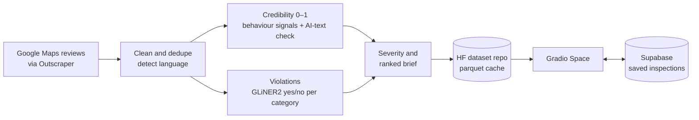

# Review Inspector

**Ranked evidence from public reviews, for inspectors in Qatar.**

[](https://hermesione-trial-review.hf.space/)
[](https://www.python.org/)
[](https://www.gradio.app/)

**Try it:** https://hermesione-trial-review.hf.space/ — no account needed.

Review Inspector reads Google Maps reviews of 10 businesses in Doha (5 restaurants, 5 hotels),
scores how credible each review looks, finds complaints that may point to a regulatory problem
(hygiene, safety, pricing fraud, licensing), and gives an inspector a ranked brief, a checklist
and a PDF report. The site and reports work in English and Arabic.

Built for the QAI x Hugging Face hackathon.

> Review Inspector helps decide **where to look first**. It never calls a review "fake" and
> never gives a safety rating. Every complaint links back to the sentence that supports it.

---

## What an inspector can do

| Step | What happens |
| --- | --- |
| **Search** | Find a business by name, or browse all 10 ranked by priority. |
| **Priority card** | Google rating, reviews analysed, and a concern level per category. |
| **Complaints** | Safety and hygiene first. The supporting sentence is highlighted. Reviews in other languages are translated, with the original language shown. |
| **Brief and report** | A short written brief and a downloadable PDF, in English or Arabic. |
| **Checklist** | Mark each issue *Confirmed*, *Ongoing*, *False alarm* or *Resolved*, and add notes. |
| **Past records** | Upload an earlier inspection record. Its date and outcome are read for you. |
| **Accounts** | Demo mode works for everyone. Sign in to save your checklists; each inspector sees only their own. |

## How it works

All heavy work runs ahead of time as Hugging Face Jobs. The Space runs no models: it only
reads cached results from a dataset repo.



1. **Ingest** – Up to 50 newest and 50 lowest-rated reviews with text per business. Duplicates
   removed, timestamps normalised, Arabic and English kept. Low ratings are over-sampled on purpose,
   so counts are not percentages of all reviews.
2. **Credibility (0–1)** – Behaviour signals (author with a single review, 5-star bursts within 48 hours,
   near-duplicate text, rating that contradicts the text) plus an AI-written-text classifier.
3. **Violations** – [`fastino/GLiNER2.5-multi-Decide`](https://huggingface.co/fastino/GLiNER2.5-multi-Decide)
   answers one yes/no question per category and returns the evidence sentence.
4. **Severity and brief** – `category weight × confidence × credible complaints per 1,000 Google reviews × recency`.
   Hygiene and safety hits are never dropped, only marked low confidence. The brief is written by an
   LLM through Hugging Face Inference Providers, with a labelled template fallback.
5. **Cache** – Results are pushed to a private Hugging Face dataset repo as parquet files.
6. **App** – A Gradio Blocks app reads the cache. Accounts and checklists are stored in Supabase
   with row-level security.

### Violation categories

| Category | Examples |
| --- | --- |
| `hygiene` | food poisoning, pests, dirty kitchen or rooms, spoiled food, bad smells |
| `safety` | fire hazards, blocked exits, injuries, broken structures, electrical danger |
| `pricing_fraud` | overcharging, hidden fees, bill different from menu, refused refund |
| `licensing` | unlicensed activity, alcohol or smoking violations, expired permits |
| `service_only` | rude staff, slow service — no regulatory issue |

### Models

| Purpose | Model |
| --- | --- |
| Violation detection | [`fastino/GLiNER2.5-multi-Decide`](https://huggingface.co/fastino/GLiNER2.5-multi-Decide) |
| AI-written text check | `xlm-roberta-base` fine-tuned on [`MichiganNLP/MAiDE-up`](https://huggingface.co/datasets/MichiganNLP/MAiDE-up) (English) |
| Briefs, translations, record reading | `zai-org/GLM-5.3` via HF Inference Providers |

**AI-text classifier, held-out test split** (10% of hotels chosen by hash of hotel name, never
seen in training; 140 English reviews):

| Accuracy | F1 | Precision | Recall |
| --- | --- | --- | --- |
| 0.921 | 0.926 | 0.873 | 0.986 |

It only checks English reviews. Reviews in other languages skip this check and are not penalised for it.

## Limitations

- Credibility and severity weights are hand-set, not calibrated.
- Violation hits have not been measured against labelled data. Expect false alarms and misses.
  Safety and licensing are the noisiest, so check the evidence before acting.
- On held-out hotel reviews the AI-text check wrongly flagged about 1 in 7 human reviews, so it
  only lowers credibility slightly.
- Priority compares these 10 businesses with each other. It is not a safety rating.
- Past inspection records shown in the demo are **sample data**, invented for the demo
  (`data/mock_inspections.json`).

## Repository layout

```text
.
├── app.py               # Gradio app (the Space entry point)
├── accounts.py          # Supabase sign-in and saved inspections
├── i18n.py              # Every word the app shows, in English and Arabic
├── records.py           # Reads uploaded past inspection records
├── report.py            # PDF report, English or Arabic
├── requirements.txt     # Space Python dependencies (pinned)
├── packages.txt         # Space system packages
├── fonts/               # IBM Plex Sans Arabic for PDFs (OFL)
├── space/README.md      # Hugging Face Space settings card
├── scripts/             # Batch jobs, run ahead of time (uv inline dependencies)
│   ├── scrape.py        #   Outscraper → raw JSON + clean parquet
│   ├── train_detector.py#   fine-tune the AI-text classifier
│   ├── pipeline.py      #   credibility, violations, severity, briefs
│   ├── translate.py     #   one-time translations for the app and reports
│   ├── deploy_space.sh  #   upload the app to the Space
│   └── checks/          #   one-off model checks from development
└── data/
    ├── businesses.json        # the 10 businesses and their search queries
    ├── mock_inspections.json  # sample inspection records (not real)
    ├── preflight.json         # review counts used to pick businesses
    ├── raw/                   # raw Outscraper responses
    └── scraped_reviews.parquet
```

The app files stay at the repo root because Hugging Face Spaces runs `app.py` from there.
The Space's settings live in `space/README.md`, which `scripts/deploy_space.sh` uploads as the Space's `README.md`.

## Running it

### The app

```bash
pip install -r requirements.txt
export HF_TOKEN=...          # read access to the dataset repo
python app.py
```

| Variable | Used for |
| --- | --- |
| `HF_TOKEN` | Download the cached results from the private dataset repo |
| `HF_INFERENCE_TOKEN` | Optional. Separate token for reading past records (falls back to `HF_TOKEN`) |
| `LOCAL_DATA_DIR` | Optional. Read the parquet files from a local folder instead of the Hub |
| `SUPABASE_URL`, `SUPABASE_PUBLISHABLE_KEY` | Optional. Point accounts at another Supabase project |

### The batch scripts

Each script declares its own dependencies inline, so it runs with `uv` locally or as a
Hugging Face Job. Run them from the repo root.

```bash
python scripts/scrape.py test                       # 1 business × 20 reviews
hf jobs uv run --flavor l4x1 --timeout 90m --secrets HF_TOKEN scripts/train_detector.py
hf jobs uv run --flavor l4x1 --timeout 2h  --secrets HF_TOKEN scripts/pipeline.py
```

Every Job pushes its outputs to the Hub before it exits.

### Deploying the Space

```bash
bash scripts/deploy_space.sh "Describe the change"
```

This uploads only the app files, fonts and `space/README.md` (as `README.md`) to the Space.

## Links

- **Live demo:** https://hermesione-trial-review.hf.space/
- **Space:** [Hermesione/trial-review](https://huggingface.co/spaces/Hermesione/trial-review)
- **Source:** [github.com/iiVertex/qaihackathon](https://github.com/iiVertex/qaihackathon)
